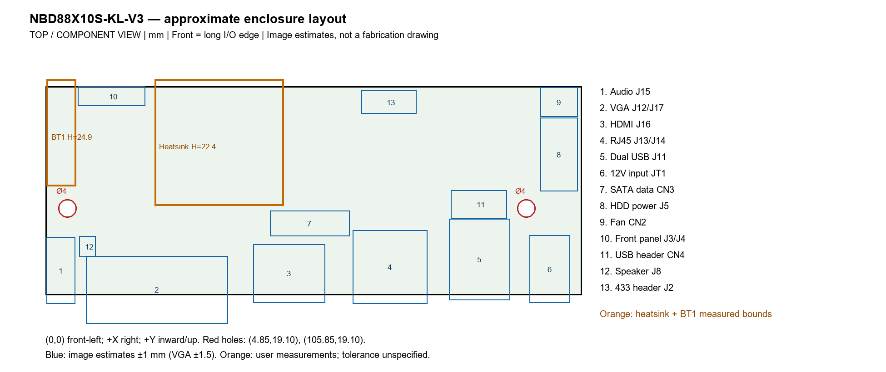

# Mechanical reference for enclosure CAD

Recorded 2026-11-11. All dimensions are millimeters.

## Scope and board variants

This supplement records an owner's physical measurements and approximate connector envelopes scaled from the JFTech NBD88X10S-KL-V3 diagram. The upstream repository documents NBD80XXS-XE V1.04, a related board. Identical mechanical layout across these variants has not been established. Do not treat the diagram-derived connector positions as physically verified dimensions of every NBD80XXS-XE board.

## Coordinate system

Top/component view. The front is the long edge carrying the external audio, VGA, HDMI, Ethernet, USB and DC sockets, in that left-to-right order in the reference diagram. Origin (0,0) is the front-left PCB corner; +X runs right, +Y runs inward toward the opposite edge. Negative Y denotes projection beyond the front edge. Heights are recorded as above the component-side PCB surface; the height datum was not independently checked.

## Owner-reported physical measurements

Measurement tolerances and instrument accuracy were not supplied. Decimal places do not establish accuracy.

| Feature | Measurement |
|---|---|
| PCB outline | 118 x 46 |
| Left mounting hole | center (4.85, 19.10), diameter 4 |
| Right mounting hole | center (105.85, 19.10), diameter 4 |
| Hole center spacing | 101 |
| Heatsink footprint | 28.46 X x 27.9 Y |
| Heatsink nearest edges | X=24 from left, Y=19.7 from front |
| Heatsink bounds | X=24 to 52.46; Y=19.7 to 47.6 |
| Heatsink height | 22.4 |
| BT1 battery holder footprint | 6.5 X x 23.6 Y |
| BT1 nearest edges | X=0.29 from left, Y=24 from front |
| BT1 bounds | X=0.29 to 6.79; Y=24 to 47.6 |
| BT1 height | 24.9 |

The heatsink X value 28.46 is interpreted as its width, retaining the previously reported 24 mm left offset. Both measured component envelopes extend 1.6 mm beyond the opposite PCB edge (Y=46). These overhangs are retained as reported, rather than adjusted to match the published photo. PCB thickness, underside protrusions, installed heatsink elevation and plug/cable clearances remain to be measured.

[Measured component bounds CSV](measured-components.csv)

## Approximate connector envelopes

The supplied 910 x 1273 pinout image contains a PCB rectangle approximately 545 x 213 pixels, scaled independently to 118 x 46 mm (about 4.62 pixels/mm in each direction). Connector outline bounds were read manually. Rendering or enlarging the image does not add measurement precision. Centers are bounding-box centers, not pin locations or panel-opening centers.

Practical uncertainty allowance: approximately +/-1 mm per connector boundary, or +/-1.5 mm for VGA/ambiguous outlines. These are judgment-based planning allowances, not statistical confidence intervals or manufacturer tolerances. Some outlines are optional/alternative footprints; verify actual population. The CSV preserves 0.1 mm calculation increments solely for CAD entry.

| Feature | Center X | Center Y | Width X | Depth Y |
|---|---:|---:|---:|---:|
| Audio J15 | 3.4 | 5.4 | 6.3 | 14.7 |
| VGA J12/J17, including ears | 24.5 | 1.2 | 31.2 | 14.9 |
| HDMI J16 | 53.6 | 4.8 | 15.8 | 13.0 |
| RJ45 J13/J14 | 75.8 | 6.2 | 16.5 | 16.2 |
| Dual USB J11 | 95.5 | 7.9 | 13.4 | 17.9 |
| DC input JT1 | 111.0 | 5.7 | 8.9 | 14.9 |
| SATA data CN3 | 58.1 | 15.8 | 17.5 | 5.6 |
| HDD power J5 | 113.0 | 31.0 | 8.2 | 16.2 |
| Fan CN2 | 113.0 | 42.5 | 8.2 | 6.5 |
| Front panel J3/J4 region | 14.5 | 43.8 | 14.7 | 4.3 |
| USB header CN4 | 95.4 | 20.0 | 12.3 | 6.3 |
| Speaker J8 | 9.2 | 10.7 | 3.7 | 4.5 |
| 433 header J2 | 75.6 | 42.5 | 12.1 | 5.2 |

[Connector bounds CSV](connector-estimates.csv)

With the reported overhang and diagram-estimated VGA projection, the combined top-view envelope spans X=0 to 118 and Y approximately -6.3 to 47.6: about 118 x 53.9 mm before enclosure clearance. This is not a finished enclosure size. Heights of the external sockets and their openings cannot be derived reliably from this diagram. Physically verify panel cutouts and clearances before fabrication.

## Sources

- Owner's physical measurements and subsequent corrections, recorded above.
- [OpenIPC board entry](https://openipc.org/cameras/boards/xiongmai-nbd88x10s-kl-v3)
- [JFTech NBD88X10S-KL-V3 PDF, photo and layout on pages 1-3](https://openipc.org/board-files/xiongmai-nbd88x10s-kl-v3-jftech/NBD88X10S-KL-V3.pdf)
- [Layout image](https://openipc.org/board-files/xiongmai-nbd88x10s-kl-v3-jftech/NBD88X10S-KL-V3-pinout-1.png)
- [Connector identification table continuation](https://openipc.org/board-files/xiongmai-nbd88x10s-kl-v3-jftech/NBD88X10S-KL-V3-pinout-2.png)
